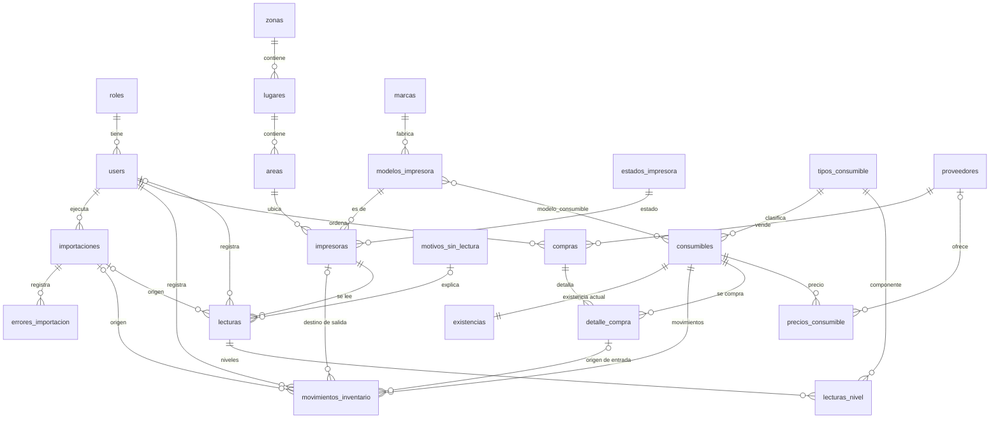

# SGIIC — Diagrama entidad-relación (Fase 2)

Refleja las migraciones verificadas. Las relaciones muestran la cardinalidad: `||` uno obligatorio, `|o` uno opcional, `o{` muchos.

## Diferencias respecto a la propuesta v1 (`modelo-datos.md`)

| Propuesta v1 | Implementado | Motivo |
|---|---|---|
| `movimientos_inventario.compra_id` | `detalle_compra_id` | Permite recepciones parciales por consumible |
| `compras.fecha_compra` | `fecha_orden` | Es la fecha de la orden, no de la recepción |
| `compras.estado`: ordenada, recibida, cancelada | Añade `parcialmente_recibida` | Recepciones parciales |
| `compras.proveedor_id` opcional | Obligatorio | Toda compra real tiene proveedor |
| `lecturas.usuario_id` opcional | Obligatorio si el origen es `manual` | Trazabilidad de quién registró |
| `lecturas`: si hay motivo, el contador es nulo | Además el contador puede ser nulo sin motivo | Regla 12: no todos los modelos entregan contador |
| Índice único de documento de compra: no previsto | Único (`proveedor_id`, `numero_documento`) cuando hay número | Evita duplicar órdenes |
| `ON DELETE RESTRICT` | `NO ACTION` | SQL Server no admite `RESTRICT` |

## Pendiente de servicios (no es posible con restricciones de la base)

- Una fila en `existencias` por cada consumible nuevo (servicio de inventario, Fase 4).
- Existencia actual igual a la suma de movimientos (comando de control, Fase 4).
- Una lectura debe traer al menos un dato: contador, niveles o motivo (servicio de lecturas, Fase 5).
- Sin vigencias de precio solapadas por consumible y proveedor (servicio de precios, Fase 4).
